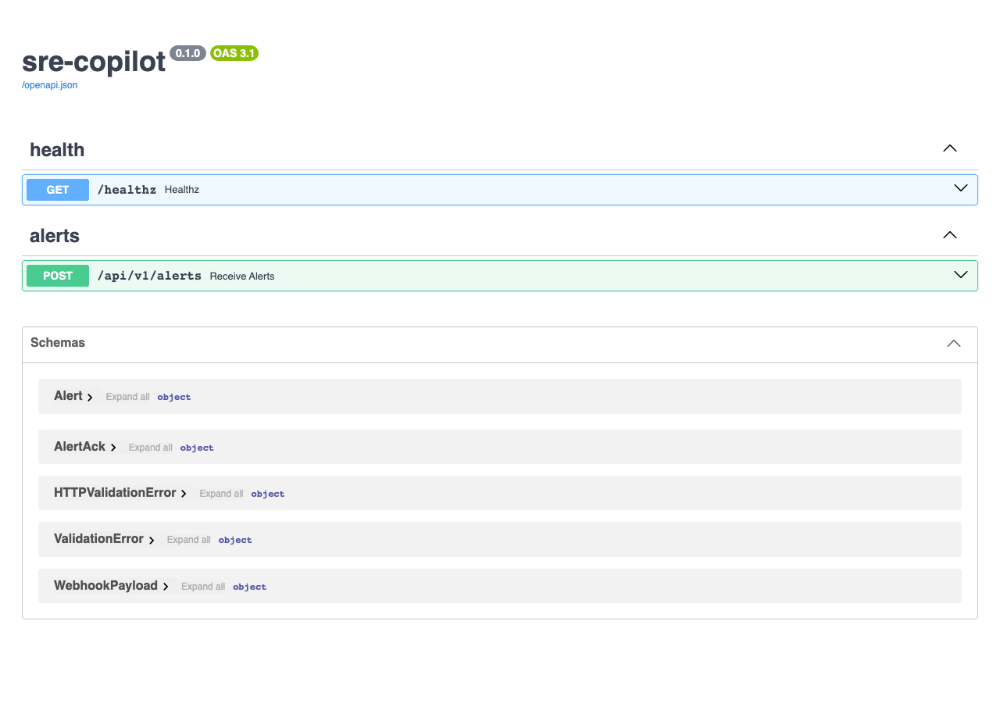
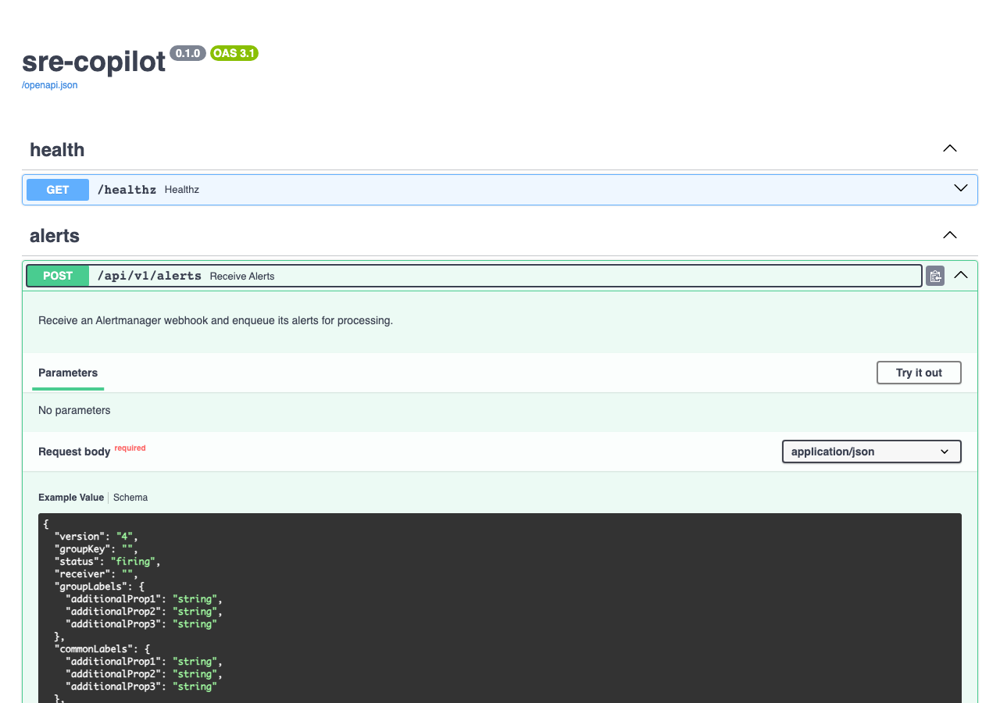
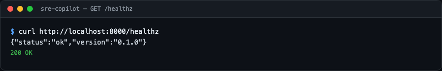
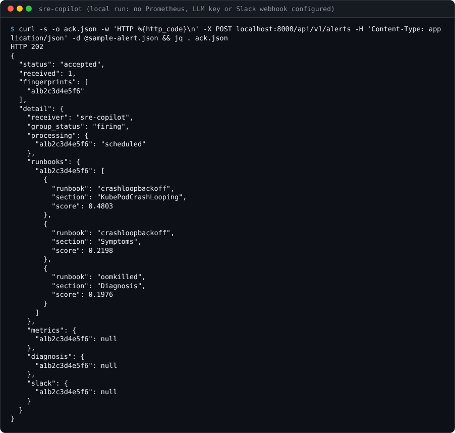
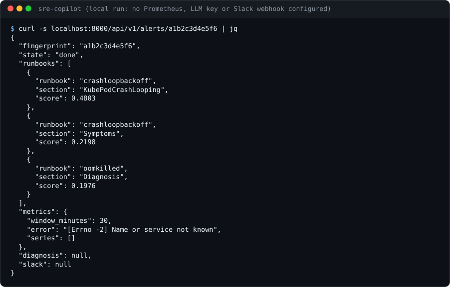
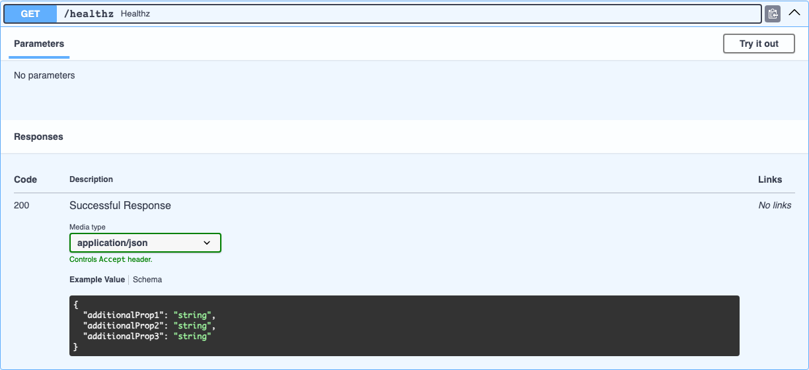
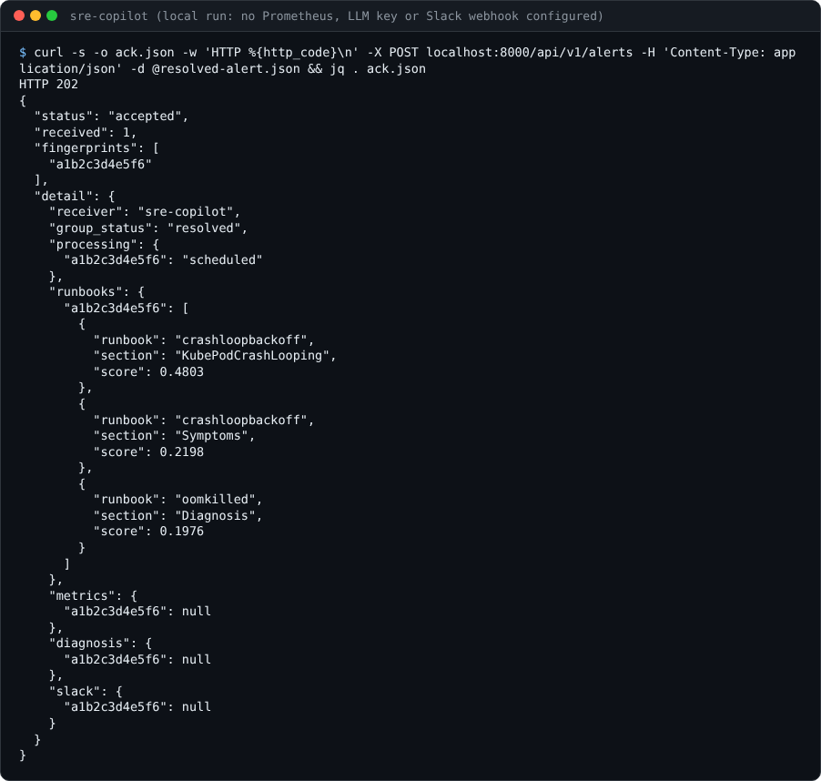

# sre-copilot

[](https://github.com/tenalisriharsha/sre-copilot/actions/workflows/ci.yml) [](LICENSE)

An AI on-call assistant for Kubernetes incidents. It ingests Prometheus
Alertmanager alerts via webhook, retrieves matching runbooks with a RAG
pipeline (ChromaDB + embeddings), correlates with recent metrics, and posts a
diagnosis plus suggested remediation steps to Slack.

## Preview

The interactive API docs FastAPI generates automatically:



<details>
<summary>More views</summary>













</details>

The terminal previews are captured from a real local run by
[`scripts/capture_previews.py`](scripts/capture_previews.py), which runs the
command shown and renders its output unmodified.

## Stack

- FastAPI + Pydantic v2 (backend, typed config)
- ChromaDB + hash or sentence-transformers embeddings (runbook RAG)
- Prometheus HTTP API (metrics correlation)
- Pluggable LLM client, fully mocked in tests
- Slack Block Kit notifications
- Helm chart deployment (planned, Phase 6; not yet in the repo)

## Quickstart (dev)

```bash
python3 -m venv .venv && source .venv/bin/activate
pip install -c constraints.txt -e '.[dev]'
pytest
uvicorn sre_copilot.main:app --reload
```

`pyproject.toml` declares lower bounds only; [`constraints.txt`](constraints.txt)
pins the full dependency tree (all extras, every platform, Python 3.12+) so
installs and CI are reproducible. `-c` only constrains versions, it never adds
packages, so the same file works with or without the `embeddings` extra.
Plain `pip install -e '.[dev]'` still works and picks the newest compatible
releases. After changing dependencies, regenerate it with
[uv](https://docs.astral.sh/uv/) (the exact command is in the file header):

```bash
uv pip compile pyproject.toml --all-extras --universal --python-version 3.12 \
  --no-emit-package sre-copilot -o constraints.txt
```

Endpoints so far:

- `GET /healthz` — liveness probe
- `POST /api/v1/alerts` — Alertmanager webhook receiver. Each alert is
  matched against the runbook index while the request is open, then
  correlated with recent Prometheus metrics, diagnosed by the LLM stage and
  posted to Slack **in the background** after the `202` is sent (see
  [Background processing](#background-processing)). In the response,
  `detail.processing` gives each fingerprint's outcome (`scheduled`,
  `duplicate` or `deferred`) and `detail.runbooks` its top-k excerpts
  (runbook, section, similarity score). `detail.metrics`, `detail.diagnosis`
  and `detail.slack` keep their shape but only hold what has already finished
  when the ack is sent: `null` for a newly scheduled alert, the stored results
  for a duplicate whose processing is complete.
- `GET /api/v1/alerts/{fingerprint}` — processing state (`processing` or
  `done`) and stage results for an alert: `runbooks`, `metrics` (a per-series
  summary: name, point count, latest value), `diagnosis` (likely cause,
  confidence, remediation steps) and `slack` (`{"delivered": true|false}`),
  each `null` when its stage is disabled or has not finished. `404` once the
  fingerprint is unknown or its state has expired.

## Background processing

Alertmanager waits for the webhook response and retries on timeout, so the
request only does fast, local work (validation and runbook retrieval). The
slow network stages (Prometheus, LLM, Slack) run in background tasks inside
the same process.

- **Bounded concurrency** — at most `SRE_COPILOT_PIPELINE_CONCURRENCY`
  alerts (default 4) are in the slow stages at once; the rest wait their turn.
- **Retry dedupe** — an alert is processed once per (fingerprint, status,
  `startsAt`). A retried or repeated delivery of the same alert is
  acknowledged with outcome `duplicate` and does not post to Slack again. A
  resolution (`firing` → `resolved`) or a new occurrence (new `startsAt`) is
  processed normally. Alerts without a fingerprint are never deduplicated.
- **Backpressure** — once `SRE_COPILOT_PIPELINE_MAX_PENDING` alerts (default
  1000) are unfinished, the webhook answers `503` and lists the `deferred`
  fingerprints. Alertmanager retries; alerts from that group that were
  already scheduled come back as `duplicate`, so only the deferred ones run.
- **Bounded state** — per-alert results, the dedupe set and the in-memory
  queue are dropped after `SRE_COPILOT_ALERT_STATE_TTL_SECONDS` (default
  3600) and capped at `SRE_COPILOT_ALERT_STATE_MAX_ENTRIES` (default 10000),
  oldest first. The TTL is also the dedupe window: Alertmanager re-sends a
  still-firing alert every `repeat_interval` (default 4h), and such a resend
  is posted again only if it arrives after the TTL.
- **Shutdown** — on a graceful shutdown, in-flight alerts get 10 seconds to
  finish and are then cancelled.

Limits: this state is in memory, per process. A restart forgets it, and
alerts acknowledged but not yet finished at a hard kill are lost (Alertmanager
only re-sends them when the group changes or after its `repeat_interval`). With several replicas, a
retry routed to a different replica is not recognized as a duplicate.

## Runbook RAG

Markdown runbooks live in [`runbooks/`](runbooks/) (CrashLoopBackOff,
OOMKilled, ImagePullBackOff, high CPU, node NotReady). At startup they are
chunked by section and indexed into a persistent ChromaDB collection
(`SRE_COPILOT_CHROMA_PERSIST_DIR`, default `.chroma/`).

Embedding backend is selectable via `SRE_COPILOT_EMBEDDING_BACKEND`:

- `hash` (default) — deterministic hashing embedder, no model download,
  works offline; used in tests
- `sentence-transformers` — real local embeddings (`SRE_COPILOT_EMBEDDING_MODEL`,
  default `all-MiniLM-L6-v2`). This needs the optional `embeddings` extra,
  which pulls in PyTorch (several GB with the default CUDA wheels on Linux):

  ```bash
  pip install -e '.[embeddings]'
  # CPU-only torch keeps it much smaller:
  pip install -e '.[embeddings]' --extra-index-url https://download.pytorch.org/whl/cpu
  ```

  Without the extra, selecting this backend fails at startup with an
  `ImportError` that names the extra to install.

Retrieval fan-out per alert is controlled by `SRE_COPILOT_RETRIEVAL_TOP_K`
(default 3).

## Metrics correlation

Each alert is correlated with recent Prometheus metrics
(`src/sre_copilot/metrics/`): the correlator builds a PromQL label selector
from the alert's `namespace`/`pod`/`container` labels and runs range queries
for CPU usage, working-set memory, and container restarts over a trailing
window.

Settings:

- `SRE_COPILOT_PROMETHEUS_URL` — base URL of the Prometheus HTTP API
  (default `http://prometheus:9090`); set empty to disable correlation
- `SRE_COPILOT_PROMETHEUS_TIMEOUT_SECONDS` (default 5)
- `SRE_COPILOT_METRICS_WINDOW_MINUTES` (default 30) and
  `SRE_COPILOT_METRICS_STEP_SECONDS` (default 60) — query window and resolution

Correlation degrades gracefully: alerts without identifying labels skip the
queries, and an unreachable Prometheus yields an empty snapshot with the error
recorded — a Prometheus outage never fails or delays the webhook ack, since
correlation runs after the ack (see [Background processing](#background-processing)).

## LLM diagnosis

Each alert is diagnosed by an LLM stage (`src/sre_copilot/llm/`): a prompt
builder assembles the alert, its runbook excerpts and its metrics summary,
and a provider-agnostic chat client (`OpenAICompatibleClient`, any
OpenAI-compatible `/chat/completions` API in JSON mode) returns a structured
`Diagnosis` — likely cause, confidence (`low`/`medium`/`high`) and ordered
remediation steps, validated against a Pydantic schema.

Settings:

- `SRE_COPILOT_LLM_API_KEY` — unset/empty disables the diagnosis stage
  entirely (default)
- `SRE_COPILOT_LLM_MODEL` (default `gpt-4o-mini`),
  `SRE_COPILOT_LLM_BASE_URL` (default `https://api.openai.com/v1`) and
  `SRE_COPILOT_LLM_TIMEOUT_SECONDS` (default 30)

Like the other stages, diagnosis degrades gracefully: an LLM or response
validation failure is logged and recorded as "no diagnosis" — the alert is
still accepted and the Slack stage still runs. Tests use a fake client implementing the
`LLMClient` protocol; no live LLM calls in CI.

## Slack notification

The final pipeline stage (`src/sre_copilot/slack/`) posts one Block Kit
message per alert to a Slack incoming webhook: a color-coded attachment
(severity sidebar: `danger` for critical, `warning` for warning, `good` for
resolved), a header with status and alertname, a context line (severity,
namespace, pod, fingerprint), the alert summary, the LLM diagnosis with
numbered remediation steps, the top runbook excerpt, and the metrics summary.
Every piece degrades to an explicit fallback sentence when its stage is
disabled or failed.

Settings:

- `SRE_COPILOT_SLACK_WEBHOOK_URL` — unset/empty disables the stage entirely
  (default)
- `SRE_COPILOT_SLACK_TIMEOUT_SECONDS` (default 5)

A failed delivery is logged and recorded per fingerprint
(`slack.delivered: false` from `GET /api/v1/alerts/{fingerprint}`) — the
alert is still accepted.
Tests mock the webhook with `httpx.MockTransport`; no live Slack calls in CI.

## Status

Phases 1 to 5 are implemented and tested: webhook ingestion, runbook retrieval, metrics correlation, LLM diagnosis and
Slack notification. **Not built yet:** the container image, the Helm chart and the architecture diagram (Phase 6 in
[PROGRESS.md](PROGRESS.md)). The service runs from source as described in the Quickstart above.

## License

[MIT](LICENSE)
